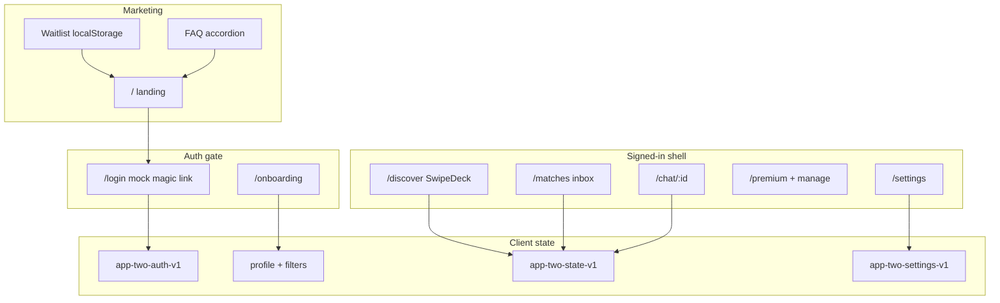

# App Two

Public-safe Tinder-style dating MVP on **Next.js 16**, **TypeScript**, and **Tailwind CSS** — swipes, matches, chat, onboarding, filters, and monetization stubs.

## Quick start

```bash
npm install
cp .env.example .env.local   # optional
npm run dev
```

1. Open [http://localhost:3000/](http://localhost:3000/) — marketing landing (logged out)
2. **Get started** → mock magic link sign-in at `/login`
3. Complete **onboarding** → **Discover** at `/discover` → Matches → chat → Premium / Likes You

## Scripts

| Script                            | Description       |
| --------------------------------- | ----------------- |
| `npm run dev`                     | Dev server        |
| `npm run build`                   | Production build  |
| `npm run start`                   | Production server |
| `npm run lint`                    | ESLint            |
| `npm run typecheck`               | TypeScript        |
| `npm run format` / `format:check` | Prettier          |
| `npm run test`                    | Vitest unit tests |

## Architecture



## Changelog

### Wave 8

- **Waitlist** on landing — mock email capture → `localStorage` list + success UI; `track('waitlist_join')`
- **FAQ accordion** — monetization & safety copy on landing
- **Theme toggle** — dark/light via CSS variables (`data-theme`), persisted in Settings
- **Match sound stub** — optional Web Audio chime on celebration (Settings toggle)
- **Recently active** — mock badge on Discover cards (deterministic per profile id)
- **Export my data** — Settings downloads JSON (profile, filters, settings, app state)
- **Rate App Two** — soft prompt after 3 matches (dismissible, mock `rate_app_mock` event)
- **65+ Vitest tests** — waitlist, theme, soft paywall, invite, export helpers
- **README** — architecture diagram (above) + mock vs production table refresh

### Wave 7

- **`/invite`** — copy-link referral stub + mock share count; Settings entry
- **Photo verified** badge on Discover cards + self preview (mock)
- **Match search** by name in inbox
- **Chat reactions** (❤️ 😂 🔥) on bubbles
- **Soft paywall interstitial** after `SOFT_PAYWALL_SWIPE_THRESHOLD` swipes (Free)
- **`track()` analytics stub** — console in dev (`signup`, swipe, `match`, `paywall_view`, `purchase_mock`)
- **CONTRIBUTING.md**, **CODE_OF_CONDUCT.md** placeholder, **MIT LICENSE**
- **50+ Vitest tests**; README mock vs production table refresh

Do **not** copy secrets, production env files, or private credentials from sibling lineages into this repo.

### Wave 6

- **16 demo profiles** — varied bios, interests, and distances (filters feel alive)
- **Match inbox** — sorted by recent message activity; **unread badges** on list + Matches tab
- **Match celebration** — full-screen modal (Send message / Keep swiping)
- **Daily like cap UX** — remaining likes counter on Discover for Free; upsell at cap
- **Legal stubs** — `/legal/privacy`, `/legal/terms`, `/legal/community` linked from landing & Settings
- **Error boundary** — client retry + `(main)/error.tsx` fallback
- **`/dev/kitchen?debug=1`** — component/state gallery for visual QA (no Storybook)
- **44+ Vitest tests** — inbox sorting/unread, daily cap, celebration triggers

**Secrets:** Do not copy API keys, env files, or private credentials from sibling or internal lineages into this public repo. App Two uses placeholders in `.env.example` only.

### Wave 5

- **`/premium/manage`** — current plan, mock renewal date, cancel / reactivate stubs, consumable inventory summary
- **Consumable shop** — Boost + Super Like packs with live inventory after mock purchase
- **Discover coach marks** — dismissible first-session tips (persisted in app state)
- **Push soft prompt** — UI stub after first new match (no real push APIs)
- **Offline banner** when `navigator.onLine` is false; optional production **`/sw.js`** registration (no asset caching)
- **Accessibility** — skip-to-content link, banner/main/nav landmarks, higher-contrast primary CTAs
- **Tests** — 30+ cases covering premium gating, onboarding gate, safety/block/report helpers, subscription manage
- **Deploy docs** — Vercel one-click notes; App Router (not static export)

### Wave 4

- **Landing** at `/` for logged-out users (hero, features, CTAs) with SEO + Open Graph placeholders
- **Shareable profiles** stub at `/u/[id]` (mock public card + sign-in CTA)
- **QA debug panel** — visible in `development` or with `?debug=1` (grant Premium, refill boosts/Super Likes, reset localStorage)
- **PWA basics** — `manifest.webmanifest`, SVG icon placeholders, `theme-color`
- **i18n scaffolding** — English string map (`src/i18n/en.ts`) for brand, nav, CTAs, loading copy
- **State polish** — shared loading/error shells on Discover, Matches, Likes You, Chat
- **Tests** — auth session helpers, boost countdown, likes-you gating, debug flag
- Discover app route moved to **`/discover`** (signed-in experience)

### Wave 3

- Multi-photo Discover cards, Premium rewind, chat safety, Likes You funnel, streak banner, Vitest for deck/match/filter

### Wave 2

- Onboarding wizard, Discover filters, profile edit, settings, match toasts, boost countdown, Super Like inventory

## Demo script (investors / QA)

| Step | Action                          | What to highlight                                       |
| ---- | ------------------------------- | ------------------------------------------------------- |
| 1    | Visit `/` logged out            | Landing hero, monetization-aware bullets, OG-ready meta |
| 2    | Open `/u/p1`                    | Shareable profile stub (Jordan)                         |
| 3    | Sign in via `/login`            | Mock magic link, no real email                          |
| 4    | Finish onboarding               | Preferences feed Discover filters                       |
| 5    | `/discover?debug=1`             | Debug panel → **Grant Premium**                         |
| 6    | Swipe Jordan (multi-photo taps) | Match toast → `/matches`                                |
| 7    | Chat with Sam (seed match)      | Typing, read receipt, 📷 stub, ⋮ safety menu            |
| 8    | `/likes-you`                    | Blurred grid on Free; Premium shows names               |
| 9    | Free tier: tap **Rewind**       | Shake + Premium upsell                                  |
| 10   | `/premium`                      | Tiers + consumable shop (inventory after mock buy)      |
| 11   | `/premium/manage`               | Renewal date, cancel / reactivate stubs                 |
| 12   | Dismiss coach marks on Discover | First-session tips overlay                              |
| 13   | `/settings`                     | Block list, notification toggles, mock delete           |

## User flows

| Flow               | Route                    | Persistence                                       |
| ------------------ | ------------------------ | ------------------------------------------------- |
| Landing            | `/`                      | Logged-out marketing; signed-in → `/discover`     |
| Public profile     | `/u/[id]`                | Mock read-only card                               |
| Sign in            | `/login`                 | `localStorage` auth + API stubs                   |
| Onboarding         | `/onboarding`            | Dating profile per user id                        |
| Discover + filters | `/discover`              | Filters + swipe state in `localStorage`           |
| Profile edit       | `/profile/edit`          | Updates Discover self-preview card                |
| Settings           | `/settings`              | Notifications, block list, legal, mock delete     |
| Likes You          | `/likes-you`             | Free blur vs Premium reveal (demo likes)          |
| Matches / chat     | `/matches`, `/chat/[id]` | Typing, read receipts, image stub, safety actions |
| Premium            | `/premium`               | Stripe checkout stub + consumable shop            |
| Manage plan        | `/premium/manage`        | Mock renewal, cancel/reactivate                   |

### Onboarding collects

Name, age, bio, photo URLs (or mock presets), interests, gender, “show me”, and preferred age range.

### Discover filters (mock location)

Distance radius slider (miles), age min/max, optional “must share interest” tags. Profiles carry demo `distanceMiles` and `gender` for filtering.

### Monetization UX

- **Free / Premium / Premium+** tier cards
- **Boost**: inventory decrements on activate; **30:00 countdown** banner while active
- **Super Like**: count on button + footer; decrements on use

Match **toasts** appear when notification toggle for matches is on (Settings).

## Mock vs production

| Area            | In this repo (mock / demo)        | Production would need                                   |
| --------------- | --------------------------------- | ------------------------------------------------------- |
| Profiles & deck | 16 static profiles, picsum photos | Real users, moderation, CDN                             |
| Location        | `distanceMiles` on cards          | GPS / geohash, privacy                                  |
| Matching        | Deterministic IDs (`p1`, `p3`, …) | Mutual-like graph, ML ranking                           |
| Chat            | localStorage + auto-replies       | WebSocket, push, media scan                             |
| Auth            | Mock magic link, no email         | SMTP/OAuth, sessions, fraud                             |
| Payments        | Mock checkout + local tier        | Stripe webhooks, entitlements                           |
| Referrals       | Copy link + local counter         | Attribution, rewards, fraud                             |
| Waitlist        | Landing form → localStorage       | ESP, double opt-in, compliance                          |
| Theme           | `data-theme` CSS variables        | System sync, design tokens                              |
| Data export     | JSON download from Settings       | GDPR pipelines, server-held data                        |
| Rate prompt     | After 3 matches, dismissible      | Store APIs, review policies                             |
| Analytics       | `console.info` in dev             | Consent, pipeline, PII rules                            |
| Push            | UI stub only                      | FCM/APNs, permissions                                   |
| Legal           | Placeholder pages                 | Counsel-reviewed policies                               |
| Secrets         | `.env.example` placeholders only  | Vault / host env — **never from private sibling repos** |

## Environment

See [`.env.example`](.env.example). Set `NEXT_PUBLIC_APP_URL` for canonical/OG URLs in production.

## Layout

```
src/app/
  page.tsx         Marketing landing (logged out)
  u/[id]/          Shareable public profile stub
  login/           Sign in
  onboarding/      First-run wizard (outside main shell)
  (main)/discover/ Signed-in swipe deck
  (main)/          matches, premium, profile, settings, chat, likes-you
  api/auth/        Magic-link stubs
  api/stripe/      Checkout + webhook stubs
src/i18n/          English string map (scaffolding)
public/            PWA manifest + icon/OG placeholders
```

## Deploy (Vercel)

App Two uses the **Next.js App Router** with API routes (`/api/auth`, `/api/stripe`). Do **not** set `output: "export"` — static export breaks auth/checkout stubs.

1. Import [MonMonMars/app-two](https://github.com/MonMonMars/app-two) in [Vercel](https://vercel.com/new) (framework preset: **Next.js** — no custom `vercel.json` required).
2. Set env vars from `.env.example` (`NEXT_PUBLIC_APP_URL` = your production URL).
3. Deploy — `npm run build` runs automatically; Node 20 matches CI.

[](https://vercel.com/new/clone?repository-url=https%3A%2F%2Fgithub.com%2FMonMonMars%2Fapp-two)

GitHub Pages / pure static hosts are unsupported unless you remove API routes.

## Screenshot placeholders (capture later)

| Screen               | Route               | Notes                        |
| -------------------- | ------------------- | ---------------------------- |
| Marketing landing    | `/`                 | Hero + feature cards         |
| Discover coach marks | `/discover`         | Tips overlay before dismiss  |
| Multi-photo card     | `/discover`         | Dot indicators + swipe       |
| Likes You blur       | `/likes-you`        | Free tier grid               |
| Premium shop         | `/premium`          | Tiers + consumable inventory |
| Manage subscription  | `/premium/manage`   | Renewal + cancel stub        |
| Push soft prompt     | `/discover`         | After first new match        |
| Public profile link  | `/u/p1`             | Share preview                |
| Chat safety          | `/chat/m-seed-1`    | Typing + read receipt        |
| Debug panel          | `/discover?debug=1` | QA tools                     |

## CI

`.github/workflows/ci.yml` — lint, typecheck, test, format, build.
